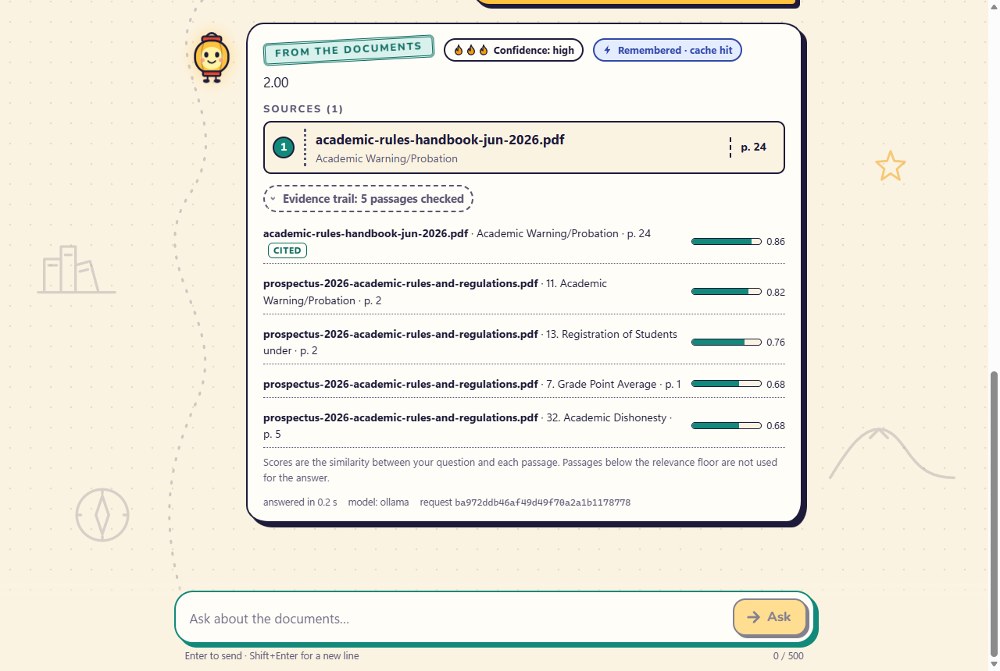
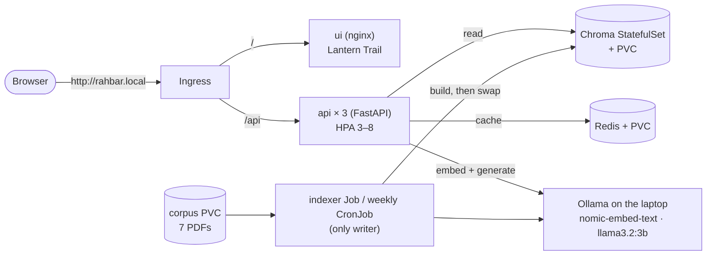

# RAHBAR: grounded answers from the university rulebooks

[](https://github.com/Swagger627/rahbar/actions/workflows/ci.yml)

**RAHBAR** ("guide" in Urdu) answers students' questions about FAST-NUCES rules: attendance,
grades, fees, campuses, academic warning and so on. It answers **only from seven official,
public university documents**, and every answer shows the document, section and page it
came from. When the documents do not cover a question, it says so instead of guessing.

It is a retrieval-augmented generation (RAG) system on Kubernetes. Its parts:
- an **indexer Job** turns the PDFs (including scanned pages, through OCR) into a vector
  index in **Chroma**;
- a 3-replica **FastAPI** service retrieves the best passages, asks a small local model
  (`llama3.2:3b` through Ollama) for an answer, checks every citation, and caches safe answers
  in **Redis**;
- an original chat UI, **Lantern Trail**.

The status badge covers `ci.yml` on this development branch. Every job passes, including
the assignment checker. While the repository is private, the badge shows only for
collaborators.



*A real answer through the real API: the "From the documents" stamp, the confidence flames,
an `X-Cache: hit` badge, and the evidence trail with each passage's similarity score. More
screenshots (night mode, phone, abstention, error) are in
[`docs/evidence/ui`](docs/evidence/ui/README.md).*

## Architecture



**How one question flows:**
1. The **semantic cache** checks whether a near-identical question (cosine similarity ≥ 0.90,
   with the same key terms) was answered recently with the same model and index. If so, it
   returns that answer in about 0.04 s.
2. **Retrieval:** the question is embedded with `nomic-embed-text`. Chroma returns the 5
   closest chunks, searching the current documents only. A cited clause number such as
   "1.21" is also matched exactly.
3. **Relevance floor:** passages scoring below 0.65 are dropped, as are passages that try to
   give the model instructions. If nothing is left, RAHBAR abstains without calling the model.
4. **Generation:** the model must reply in a fixed JSON schema (answer, citations,
   answered_from_context, confidence).
5. **Citation check:** every citation must match a passage retrieved for this request. The
   model gets one retry; after a second bad reply, RAHBAR gives a safe refusal.
6. **Store:** a grounded, cited answer is cached for 1 hour. Abstentions and safe refusals
   are never cached. A question about an old edition is cached like any other answer, but
   it can only be reused by another question about an old edition: "history" is one of the
   key terms the two questions must share.

More detail:
- why Chroma is a StatefulSet, and the allowed network paths: [docs/ARCHITECTURE.md](docs/ARCHITECTURE.md);
- the four design decisions: [docs/adr/](docs/adr/).

## What you need

| Requirement | Used for |
| --- | --- |
| Windows, macOS or Linux, about **6 GB of free RAM** while everything runs (minikube 4 GB plus Ollama) | |
| Docker Desktop | images, and minikube's driver |
| [minikube](https://minikube.sigs.k8s.io/) v1.39 and kubectl | the local cluster |
| [Ollama](https://ollama.com/) | the two models, on the host |
| Python 3.12 or newer | tests, the corpus download, the evaluation |

## From a clean clone to an answered question

The commands are for **PowerShell** on Windows (the development machine). In Git Bash, put
`MSYS_NO_PATHCONV=1` in front of `kubectl cp` and `kubectl exec` commands that contain a
path. **Always pass `--context minikube`**: on the development laptop, the default context
belongs to another project.

**1. Get the code and the tools.**
```powershell
git clone https://github.com/Swagger627/rahbar.git; cd rahbar
python -m venv .venv
.venv\Scripts\pip install -r api/requirements-dev.txt -r indexer/requirements-dev.txt
ollama pull nomic-embed-text
ollama pull llama3.2:3b
```

**2. Get the seven documents, and prove they are the right bytes.** The PDFs are public, but
they are **not committed**. `corpus/sources.yaml` lists their official URLs, and
`corpus/MANIFEST.md` records each file's size and SHA-256.
```powershell
.venv\Scripts\python corpus\fetch.py            # downloads to corpus\raw\ and writes _index.json
.venv\Scripts\python corpus\fetch.py --verify   # re-hashes every file against MANIFEST.md
```

**3. Start the cluster** (Calico, so NetworkPolicies are really enforced).
```powershell
minikube start --driver=docker --cni=calico --memory=4096 --cpus=4 --keep-context=true
minikube addons enable metrics-server
minikube addons enable ingress
kubectl config current-context    # if it now says "minikube", switch back to your own default
```

**4. Build the three images inside minikube's reach.**
```powershell
docker build -t rahbar-api:dev api;  docker build -t rahbar-indexer:dev indexer;  docker build -t rahbar-ui:dev ui
minikube image load rahbar-api:dev; minikube image load rahbar-indexer:dev; minikube image load rahbar-ui:dev
```

**5. Apply, in this exact order.** If minikube is already your current kubectl context,
`--context minikube` can be dropped. Step a is then simply `kubectl apply -k k8s/overlays/dev`.
```powershell
# a) everything except the one-time pieces: namespace, ConfigMap, PVCs, Chroma, Redis,
#    api, ui, CronJob, Services, Ingress, NetworkPolicies, HPA
kubectl --context minikube apply -k k8s/overlays/dev

# b) copy the verified PDFs into the corpus PVC through a short-lived loader pod
kubectl --context minikube apply -f k8s/base/corpus-loader.yaml
kubectl --context minikube wait -n rahbar --for=condition=Ready pod/corpus-loader --timeout=180s
kubectl --context minikube cp corpus/raw/. rahbar/corpus-loader:/corpus
kubectl --context minikube exec -n rahbar corpus-loader -- python -m pipeline.run --verify-corpus
kubectl --context minikube delete pod corpus-loader -n rahbar

# c) build the first index with the real indexer Job (about 3 minutes, 431 chunks)
kubectl --context minikube apply -f k8s/base/indexer-job.yaml
kubectl --context minikube wait -n rahbar --for=condition=complete job/indexer --timeout=900s

# d) the api becomes ready only once the index exists, is non-empty and matches EMBED_MODEL
kubectl --context minikube rollout status deploy/api -n rahbar
```

- **Before step c**, check that the cluster can reach Ollama on the host:
  `minikube ssh "curl -s http://host.minikube.internal:11434/api/version"`.
- The NetworkPolicies allow Ollama at `192.168.65.254/32`, which is Docker Desktop's host
  address. If `minikube ssh "grep host.minikube.internal /etc/hosts"` prints a different
  address, update the two Ollama rules in `k8s/base/networkpolicy.yaml`.
- [docs/DEPLOYMENT.md](docs/DEPLOYMENT.md) has every step with its expected output.

**6. Open it.** On Windows with the docker driver, reach the Ingress through a port-forward:
```powershell
kubectl --context minikube -n ingress-nginx port-forward svc/ingress-nginx-controller 18081:80
```
Then add the line `127.0.0.1 rahbar.local` to your hosts file and open
**http://rahbar.local:18081**. Or ask from the terminal:
```powershell
curl.exe -H "Host: rahbar.local" -H "Content-Type: application/json" -d '{\"question\":\"What CGPA puts a student on academic warning?\"}' http://127.0.0.1:18081/api/ask
```

**Re-index later**, for example after adding a document, with no redeploy:
`kubectl --context minikube create job --from=cronjob/reindex manual-reindex-1 -n rahbar`.
The CronJob also runs every Sunday at 03:00.

## API

Through the Ingress, only `/api/*` reaches the api. The other endpoints are for Kubernetes
probes and monitoring inside the cluster.

| Method | Path | What it does |
| --- | --- | --- |
| POST | `/api/ask` | Body `{"question": "..."}` (3-500 characters). Returns `answer`, `citations` (source, section, page), `answered_from_context`, `confidence` (high/medium/low), `retrieved` (chunk ids and similarity scores), `provider`, `request_id`. The header `X-Cache` is `hit`, `miss`, `error` or `off`. 422 for a bad question; 503 when the index is not usable |
| GET | `/healthz` | Liveness: is the process alive? Never touches Chroma, Redis or the model |
| GET | `/readyz` | Readiness: 200 only when Chroma answers, the collection exists and is non-empty, it was built with the same `EMBED_MODEL`, and Redis answers. Otherwise 503 with the reason |
| GET | `/metrics` | Prometheus: request count and latency, retrieval and generation latency, cache hits and misses, answers by outcome (answered / abstained / fallback), retries, tokens in and out |

## Tests and evaluation

```powershell
cd api; ..\.venv\Scripts\python -m pytest -q --cov=app; cd ..       # stub model, no network
cd indexer; ..\.venv\Scripts\python -m pytest -q; cd ..
.venv\Scripts\python -m pytest -q eval/tests
.venv\Scripts\ruff check api indexer eval corpus
```

The real evaluation runs the 16-question golden set (`eval/golden.yaml`) against the live
stack, and applies the regression gate:
- recall@5 at most 5 points below `eval/baseline.json`;
- every must-abstain question abstains;
- citation validity of at least 95%.

```powershell
kubectl --context minikube -n rahbar exec deploy/redis -- redis-cli FLUSHALL   # cold run
.venv\Scripts\python eval/run_eval.py --api http://127.0.0.1:18081 --host rahbar.local --golden eval/golden.yaml --baseline eval/baseline.json --out eval/results.json
```

**Latest real results** (2026-11-06, five cold runs, [docs/EVALUATION.md](docs/EVALUATION.md)):
- **Retrieval:** recall@3 = recall@5 = 1.0.
- **Citations:** automatic citation validity 1.0.
- **Abstention:** must-abstain correctness 1.0.
- **Speed:** median 1.7 s per generated answer, 0.03-0.06 s from the cache.
- **But recall is not correctness.** A manual review of one run found 9 of 14 answerable
  questions answered correctly and properly cited. One number was wrong, one answer
  mis-cited, and three answerable questions were declined. The small model also varies from
  run to run.

**On GitHub**, [`ci.yml`](.github/workflows/ci.yml) runs on every pull request. It runs lint,
tests with coverage, kubeconform on the manifests, image builds, and a Trivy scan that fails
on fixable HIGH/CRITICAL findings. Its e2e job builds a kind cluster with Ollama and the same
models, indexes three fictional fixture documents through the real indexer Job, and applies
the same gate. Details: [docs/CI-CD.md](docs/CI-CD.md).

## Security

- **Defence in depth on the network:**
  - every pod runs as non-root, with a read-only root filesystem, all capabilities dropped,
    and its own ServiceAccount with no token mounted;
  - NetworkPolicies deny by default; the ui cannot reach Chroma or Redis (verified on Calico).
- **Untrusted text:**
  - model output and document text are untrusted;
  - answers must match a JSON schema and cite only retrieved chunks;
  - passages that try to instruct the model are dropped;
  - the UI renders everything as plain text, under a strict Content-Security-Policy.
- **No secrets in Git.** The optional `hosted` provider's key comes from the Secret
  `rahbar-secret`, created on the command line:
  `kubectl create secret generic rahbar-secret -n rahbar --from-literal=LLM_API_KEY="$env:LLM_API_KEY"`.
  Base64 is not encryption.
- **Images:** pinned by digest, and scanned by Trivy in CI.

## Known limitations

- **The answer model is small and runs on one laptop.** `llama3.2:3b` sometimes declines
  questions it could answer, and occasionally misreads a table. Scaling the api does not add
  model capacity, and the CPU-based HPA does not see generation load
  ([docs/ENGINEERING-NOTES.md](docs/ENGINEERING-NOTES.md), Q3).
- **The evaluation is small.** 14 answerable questions; recall is matched by document and
  section; answer quality is checked by hand, not by the gate.
- **Not demonstrated yet:**
  - `cd.yml` (Docker Hub publish and deploy) has never run: the Docker Hub secrets are not
    set, and it only runs after a merge into `dev`/`main`;
  - the `hosted` provider has not been tried against a real cloud endpoint;
  - **the approval on `main`**: branch protection requires 1 approving review on `main`. It
    was enforced and screenshotted while the repository was public
    ([docs/evidence/github/](docs/evidence/github/README.md)), but nobody has approved yet.
    A private repository on the free plan keeps the rules without enforcing them.
- **The cluster needs the host.** `ollama-host` means the cluster depends on Ollama running
  on the host, at the address in the NetworkPolicy.

## Documentation

| Document | What is in it |
| --- | --- |
| [docs/DEPLOYMENT.md](docs/DEPLOYMENT.md) | minikube step by step, with live results |
| [docs/ARCHITECTURE.md](docs/ARCHITECTURE.md) | components, StatefulSet reasoning, network paths |
| [docs/PIPELINE.md](docs/PIPELINE.md) | extraction, chunking, retrieval, generation and cache: measurements and choices |
| [docs/EVALUATION.md](docs/EVALUATION.md) | the real-corpus evaluation and the baseline |
| [docs/FAILURE-ANALYSIS.md](docs/FAILURE-ANALYSIS.md) | four stages broken on purpose: symptoms, diagnosis, remedy |
| [docs/ENGINEERING-NOTES.md](docs/ENGINEERING-NOTES.md) | the seven engineering questions |
| [docs/CI-CD.md](docs/CI-CD.md) | workflows, the e2e test, security fixes, deploying and rolling back |
| [docs/CORPUS.md](docs/CORPUS.md) | why these seven documents |
| [docs/adr/](docs/adr/) | 0001 indexer as a Job · 0002 chunking · 0003 cache in Redis · 0004 LLM provider and data governance |
| [docs/AI-USAGE.md](docs/AI-USAGE.md) | how AI assistance was used |
| [docs/evidence/](docs/evidence/) | raw command output, evaluation runs and screenshots |
