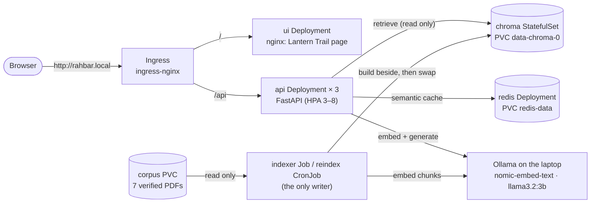

# Architecture

Everything runs in the namespace `rahbar`. The manifests are in `k8s/base`, applied through
`k8s/overlays/dev` (minikube) or `k8s/overlays/prod` (CI). All four Services are ClusterIP;
only the Ingress is reachable from outside.

| Component | Kind | Job in the system |
| --- | --- | --- |
| ui | Deployment (1) | Static page (`ui/index.html`, `styles.css`, `app.js`) served by unprivileged nginx on 8080, read-only root filesystem, strict Content-Security-Policy |
| api | Deployment (3), HPA 3–8 on CPU | `POST /api/ask`: semantic cache → retrieve (top 5) → relevance floor → drop passages that give instructions → generate → check citations (one retry) → answer. Also `/healthz`, `/readyz` and `/metrics`. **It never writes to Chroma** |
| chroma | StatefulSet (1) with `volumeClaimTemplates` | The vector index (collection `rahbar`, 431 chunks), with the embedding model and dimension in the collection metadata |
| redis | Deployment (1) + PVC | Semantic cache, namespaced by embedding model and index version, 1 h TTL |
| indexer | Job (first index), CronJob `reindex` (weekly, `concurrencyPolicy: Forbid`) | extract (OCR for scanned pages) → clean → chunk → embed → write a staging collection → swap |
| corpus | PVC (1 Gi) | The 7 PDFs plus `_index.json` with their SHA-256 checksums, copied in once through `corpus-loader.yaml` |
| Ollama | outside the cluster | Embeddings, and generation in the default `ollama-host` mode (ADR 0004) |

## Why Chroma is a StatefulSet, not a Deployment

- **Its data is on disk, and the pod must find the same disk again.** The StatefulSet gives
  `chroma-0` a stable name, and a PVC from `volumeClaimTemplates`
  (`k8s/base/chroma-statefulset.yaml:89`) that stays bound to it across restarts and
  reschedules. A Deployment's pods are interchangeable and get new names.
- **A Deployment rolling update would break it.** With a shared `ReadWriteOnce` volume, the
  new pod could not mount it while the old one still held it. With `emptyDir`, every restart
  would lose the index.
- **One writer, one copy.** Chroma here is a single-node database: `replicas: 1`, and two
  pods writing the same files would corrupt them. A StatefulSet makes "exactly this one pod
  owns this volume" explicit, and stops and starts it in order.
- **Checked for real.** On the live cluster, after deleting the Chroma and Redis pods, the
  index still had 431 rows and the next question was a cache hit (`docs/DEPLOYMENT.md`,
  "Live results").

Redis is a Deployment with its own PVC instead. It is a cache: losing it costs speed, never
correctness, and Redis needs no stable network identity.

## Why the indexer is a Job

Indexing at API start-up would mean three replicas writing one index, a re-index on every
restart, and a readiness probe that lies. See `docs/adr/0001-indexer-as-job.md` and
`docs/ENGINEERING-NOTES.md` (Q1).

## Network paths (NetworkPolicies, enforced by Calico)

Deny by default, then allow only these paths:

| From | To | Allowed |
| --- | --- | --- |
| ingress-nginx | ui :8080, api :8000 | yes |
| ui | api :8000 | yes |
| api | chroma :8000, redis :6379, Ollama (host IP, TCP 11434), DNS | yes |
| indexer | chroma :8000, Ollama, DNS | yes |
| ui | chroma, redis | **no**: checked on the live cluster (timeouts; `docs/evidence/rollout-2026-11-06.txt`) |
| anything else | chroma, redis | **no** |

## Configuration and secrets

- **ConfigMap `rahbar-config`** holds every tunable: model names, `OLLAMA_URL`, chunk
  size/overlap, `TOP_K`, `RELEVANCE_FLOOR`, `TEMPERATURE`, the cache threshold and TTL, and
  `REDIS_URL`.
- **The `hosted` key** comes from the Secret `rahbar-secret`, created on the command line.
  Only a placeholder is committed (`k8s/base/secret.placeholder.yaml`).

Every pod:
- runs as a non-root user with a read-only root filesystem and all capabilities dropped;
- uses its own ServiceAccount, with `automountServiceAccountToken: false`.
